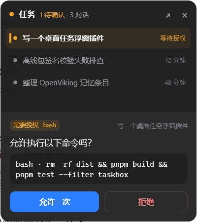
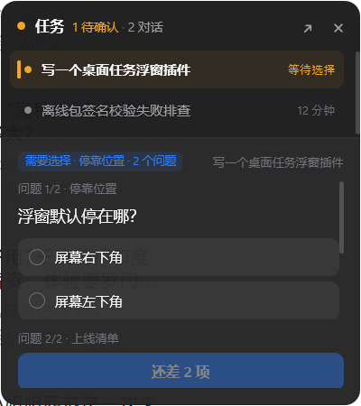
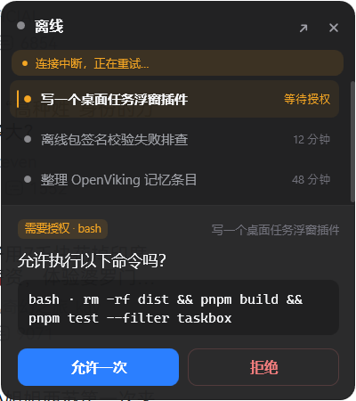

# 桌面任务浮窗 · dsh-taskbox

> **DSH（DeepSeek Harness）桌面端插件**：在 Windows 桌面上留一个**始终置顶的小方框**，实时显示每个对话
> 在跑什么、几个在等确认；需要**工具授权**或 **`ask_user_question` 选择**时，直接在小窗里点选；
> 点一下就能把 DSH 主窗口唤回前台。把 DSH 放后台干活时，不用来回切窗口。

*A tiny always-on-top desktop widget for DeepSeek Harness (DSH): live status for every conversation,
inline answers for tool approvals and questions, one click back to the main window.*

| 深色 · 待确认 | 浅色 · 紧凑态 |
|---|---|
|  |  |

## 特性

- **始终置顶**：无边框、圆角、不进任务栏；DSH 最小化/被其他窗口盖住时也能看见，点一下把主窗口唤回前台。
- **对话状态实时可见**：会话列表 + 总数，按 `等待确认 → 进行中 → 空闲` 排序；进行中的行显示当前步骤
  （`bash · pnpm test`、`edit · index.js`、`web_search · wpf topmost` …）。
- **就地确认**：工具授权（允许一次 / 拒绝）、`ask_user_question`（单选、多选、一次多题）都能在小窗里答，
  不用切回主窗口。
- **高度随内容自适应**：只有一两个对话时收成窄条，有待确认卡片时展开到最高；位置会记住。
- **关掉不丢**：用户主动关掉后，遇到**新的待确认**会自动再弹出来；随时可在 DSH 里输入 `/taskbox` 唤回。
- **小窗优先**：小窗在跑时，确认先留在浮窗里（默认 20 秒），在这段时间内作答不会在主窗口留下第二张卡片。
- 深/浅色跟随系统、多屏与不同 DPI 下位置校正、Host 挂掉时显示「离线」并在约 60 秒后自行退出。

## 截图

| 多问题（单选 + 多选） | 离线态 |
|---|---|
|  |  |

## 安装

前置：**Windows 10/11** + DSH 桌面端（插件运行在桌面端的 Host 进程里，用系统自带的
PowerShell 5.1 + .NET Framework 4.8 拉起小窗，不需要额外安装运行时）。

### 方式 A：通过插件市场（推荐）

1. DSH 侧边栏 → **插件** → **更多** → 启用 **「自定义插件市场」**（实验性）；
2. 打开 **发现** 标签 → **添加索引源**，填入：

   ```
   https://pointer-a.github.io/dsh-Desktop-floating-window/v1/plugins.json
   ```

3. 在列表里找到 **桌面任务浮窗** → 安装 → 按提示重启客户端（首次安装需要让 Host 加载新插件）。

### 方式 B：宿主内置 `plugin_manager`

在 DSH 会话里直接说：

> 请用 `plugin_manager` 安装 `dsh-taskbox`（npm），装完告诉我是否需要重启。

或者手动调 `plugin_manager`：`install_bundle`，`target` 填 `dsh-taskbox`。
桌面端读的是 `desktop` profile，**不要**用 `dsh plugin --profile desktop`（会被设计性拒绝）。

### 方式 C：本地开发目录

```powershell
git clone https://github.com/pointer-a/dsh-Desktop-floating-window.git
# 然后在 DSH 里用 plugin_manager 安装本地的 pkg 目录：
#   install_bundle  target: "<仓库路径>\pkg"
```

安装后若浮窗没有出现，**完全退出客户端（含托盘）再打开**。

## 使用

| 操作 | 行为 |
|---|---|
| 拖动标题栏 | 移动窗口，位置写入 `$DSH_HOME/task-box/window.json` |
| 双击标题栏 / 折叠 | 收成 320×44 的一行摘要；有待确认时标题栏琥珀色呼吸 |
| 点某一行对话 | 把 DSH 主窗口还原并置前 |
| `⤢` | 同上（唤回主窗） |
| `✕` | 关闭小窗；之后遇到新的待确认会自动再弹，或用 `/taskbox` 唤回 |
| 「允许一次 / 拒绝」 | 直接对该次工具授权作答 |
| 选项 / 勾选后「提交」 | 直接回答 `ask_user_question` |
| DSH 里输入 `/taskbox` | 手动唤回小窗 |

## 配置

| 环境变量 | 默认 | 说明 |
|---|---|---|
| `DSH_TASKBOX_AUTOSTART` | `1` | `0` = 不自动拉起小窗（仍可用 `/taskbox`） |
| `DSH_TASKBOX_FORWARD_DELAY_MS` | `20000` | 小窗运行时，确认先留在小窗多久再转发给 DSH 浏览器界面（`0` = 立刻转发） |
| `DSH_TASKBOX_DEBUG` | 未设 | 设任意值把插件日志也打到 Host 的 stdout |

运行数据都在 `$DSH_HOME/task-box/`（`$DSH_HOME` 缺省为 `%USERPROFILE%\.dsh`）：
`server.json`（本地端口 + 每次启动随机 token）、`window.json`（位置）、`host.log`、`minibox.log`。

## 工作原理（为什么是「独立进程 + 本地 HTTP」）

DSH 桌面端是 Electron：Web GUI 在壳的 `BrowserWindow` 里，而 **Host 插件跑在一个独立的 Node 子进程**里，
拿不到 `BrowserWindow`，也无法创建 OS 窗口。所以本插件拆成两半：

```
DSH Host 进程 (Node)                          独立小窗进程 (PowerShell + WPF)
┌──────────────────────────────┐              ┌───────────────────────────┐
│ pkg/lib/                     │  127.0.0.1   │ pkg/assets/minibox/       │
│  · 聚合会话/运行状态          │◀──GET /state─│  · 置顶无边框圆角窗口      │
│  · prepend 拦截 approval/    │              │  · 1s 轮询、状态列表       │
│    request、user-questions/  │─POST /action▶│  · 确认卡片（按钮/复选）    │
│    request 两个 waterfall     │  POST /window│  · 唤回主窗、折叠、拖拽     │
│  · 拉起/回收小窗、token 鉴权  │              │                           │
└──────────────────────────────┘              └───────────────────────────┘
```

- 本地 HTTP **只监听 `127.0.0.1`**，端口临时分配、token 每次启动重新生成；不联网、不读凭据。
- 确认通过 DSH 的 `approval/request` / `user-questions/request` waterfall 认领：小窗作答即返回结果，
  小窗不在或超时才把请求交给 DSH 自己的浏览器界面。
- 小窗是**独立进程**，Host 崩溃后它连续失败约 60 秒会自己退出；Host 重启会拉起新窗并沿用上次位置。

协议细节见 [`docs/PROTOCOL.md`](docs/PROTOCOL.md)；DSH Host 侧 API 调研笔记（带出处与行号）见
[`docs/API-NOTES.md`](docs/API-NOTES.md)。

## 目录结构

```
pkg/                     要安装/发布的插件包（npm 包 dsh-taskbox）
  lib/                   Host 半区：index / store / asks / dsh-adapters / http / window
  assets/minibox/        小窗进程（单文件 PowerShell + WPF，零第三方依赖）
  locale/                插件市场里的标题与描述
  icon.svg  cordis.patch.yml  README.md
catalog/                 社区插件市场的索引源（部署到 GitHub Pages）
docs/                    协议、调研笔记、小窗自测、验收截图
mock/mock-host.mjs       协议模拟器：不开 DSH 就能驱动小窗的 8 种画面
test/                    离线自检 + 真机开窗联调 + 截图/窗口控制脚本
scripts/                 索引生成与校验
```

## 开发 / 自检

```powershell
# 1) Host 逻辑（不需要装 DSH）：鉴权、会话状态、授权与提问的认领链路
node test/host-selftest.mjs

# 2) 「小窗优先」竞速：宽限期内不转发、超时转发、abort
node test/race-selftest.mjs

# 3) 手动玩小窗（真正的 WPF 窗口 + 模拟 Host）
node mock/mock-host.mjs --scenario approval --spawn

# 4) 真机联调：真 Host 半区拉起真小窗、自动截图、自动关闭
node test/live-window.mjs
```

发布流程：`npm version <x.y.z>` → `node scripts/build-catalog.mjs` → `git push`（Pages 工作流会校验并部署索引）
→ `npm publish`。

## 兼容性与已知限制

- 仅 Windows（WPF + Win32 窗口唤醒）；Windows 10/11，125%/150% 缩放下已验证，混合 DPI 多屏未做穷举。
- 需要支持 `ask_user_question` / `approval` waterfall 的 DSH 版本（0.2.x 桌面端）。
- `ask_user_question` 里**需要输入文字**的问题无法在小窗作答（小窗没有输入法环境），卡片会提示「去主窗口回答」。
- 确认是**一条请求的两个入口**：如果在小窗优先的宽限期（默认 20s）过后才在浮窗作答，DSH 主窗口那张卡
  可能滞留到该轮工具结束（客户端行为，插件无法撤回已转发的请求）。
- 升级需要先卸载再安装（插件市场的通用限制）。

## 隐私

- 本地 HTTP 只绑回环地址，token 每次启动重生成；插件**不联网、不读凭据**。
- 日志里只有会话标题、工具名与命令片段，全部写在 `$DSH_HOME/task-box/` 下，可随时删除。

## License

[MIT](LICENSE)
