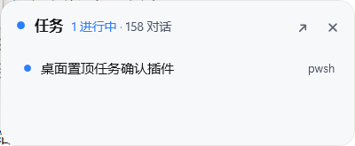

# dsh-taskbox —— DSH 桌面任务浮窗（交付说明）

给 DeepSeek Harness（DSH 桌面端）写的插件：把 DSH 放后台干活时，Windows 桌面上留一个**始终置顶的小方框**，
实时显示各对话的运行状态；需要工具授权 / `ask_user_question` 选择时，**直接在小窗里点选**；点一下把 DSH 主窗口唤回前台。
窗口高度随内容自适应（最少「标题栏 + 2 行」，最多 6 行；有确认卡片时展开到最高）。




| 目录 / 文件 | 作用 |
|---|---|
| [`pkg/`](pkg) | **要安装的插件包**（`package.json` / `cordis.patch.yml` / `lib/` / `assets/minibox/` / `locale/` / `icon.svg` / `README.md`） |
| [`pkg/README.md`](pkg/README.md) | 使用者文档：交互、安装、环境变量、数据落点、「小窗优先」确认时序、限制 |
| [`docs/PROTOCOL.md`](docs/PROTOCOL.md) | Host 半区 ↔ 小窗进程的 HTTP 协议（两份实现的唯一契约，v1 + v1.1） |
| [`docs/API-NOTES.md`](docs/API-NOTES.md) | 本次调研的 DSH Host API 契约笔记（会话列表、授权/提问 waterfall、命令注册等，带出处与行号） |
| [`docs/minibox-selftest.md`](docs/minibox-selftest.md) | 小窗半区自测：场景矩阵、位置/自适应实测、遗留项 |
| [`mock/mock-host.mjs`](mock/mock-host.mjs) | 协议模拟器：不开 DSH 就能驱动小窗的 8 种画面（`--scenario approval --spawn`） |
| [`test/`](test) | 离线自检：`host-selftest.mjs`、`race-selftest.mjs`、`live-window.mjs`、`capture.ps1`、`window-control.ps1` |
| [`docs/shots/`](docs/shots) | 视觉验收截图（含真机截图 `real-dsh-*`、`v3-*`、`v4-default-placement`、`v5-*`） |

> 仓库根就是本目录（`E:\dsh插件\桌面任务悬浮窗口`），一个插件一个仓库；上一级 `E:\dsh插件` 用于并排存放其他插件。

## 为什么是「独立进程 + 本地 HTTP」

DSH 桌面端是 Electron：Web GUI 在壳的 `BrowserWindow` 里，而 **Host 插件跑在一个独立的 Node 子进程**里
（`@deepseek-ai/dsh-desktop-host`），拿不到 `BrowserWindow`，也不能创建 OS 窗口。所以：

- **Host 半区**（`pkg/lib/`）聚合状态，起一个只监听 `127.0.0.1` 的临时端口（每次启动随机 token）；
- **小窗**（`pkg/assets/minibox/minibox.ps1`，单文件 PowerShell 5.1 + WPF）是 Host spawn 出来的独立进程：
  无边框 / 圆角 / `Topmost` / 不进任务栏，靠 1s 轮询 `/state` 拿数据，靠 `POST /action` 回传点击。

这是「DSH 最小化到后台仍能看见并确认」唯一可行的做法。

## 安装状态（本机已装好）

```
bundle: dsh-taskbox 0.1.0   application: applied
```

插件以 **`link:` 方式**安装，指向本目录的 `pkg/`：**移动/删除本目录会让插件失效**，需要重新 `install_bundle`。
桌面端读 `desktop` profile，`dsh plugin --profile desktop` 会被设计性拒绝，因此安装/卸载都走宿主内置的 `plugin_manager`：

```
install_bundle   target: "E:\\dsh插件\\桌面任务悬浮窗口\\pkg"
remove_bundle    target: dsh-taskbox
```

改完 `pkg/lib/`（Host 半区）需要让 Host 重新加载：先用 `remove_bundle` 再 `install_bundle`（会重新实例化，无需重启客户端）；
只改 `pkg/assets/minibox/minibox.ps1` 的话，让窗口重新拉起即可（关掉小窗 → 如果有新确认会自动回来，或用 `/taskbox`）。

## 自检（不需要安装也能跑）

```powershell
node test/host-selftest.mjs     # Host 逻辑：鉴权/会话状态/授权与提问的认领链路（17 项）
node test/race-selftest.mjs     # 「小窗优先」竞速：宽限期内不转发、超时转发、abort（7 项）
node test/live-window.mjs       # 真 Host 半区拉起真小窗、自动截图、自动关闭
node mock/mock-host.mjs --scenario approval --spawn   # 手动玩小窗：8 个剧本
```

## 真机验证记录（2026-10-28，DSH 桌面端 / 本机双屏 125%）

| 项 | 结果 |
|---|---|
| 插件加载 / 小窗自动拉起 / 轮询 | ✅ `host.log`：`booted` → `minibox spawned` → `minibox ready` |
| 会话列表与计数（真实数据） | ✅ 读到当前对话「桌面置顶任务确认插件 · pwsh」；`158` 对话总数；子智能体会话/空会话已过滤 |
| **在浮窗里批准工具授权** | ✅ 真机触发一次 `danger-full-access` 探针命令，在浮窗点「允许一次」→ Host 收到 `allowed-once` → 命令执行 |
| **在浮窗里回答 `ask_user_question`** | ✅ 三次真机问答均由浮窗作答并回传给模型（`ask N answered`） |
| 关掉小窗后「有新确认自动回来」 | ✅ `/action close` → 新确认 → 自动重新拉起 |
| 默认位置（右下角、多屏、离谱坐标回退） | ✅ 400×450 → 收在 `2140,910`；异常坐标回落默认 |
| 高度自适应 | ✅ 1 行时 400×165（132 DIP），有卡片 400×450（360 DIP） |
| 插件在 DSH 插件页的展示 | ✅ 标题「桌面任务浮窗」+ 中文描述 + 自绘图标，开关可切换 |
| 点击会话行唤回主窗 / 拖动记忆 / 双击折叠 | ⚠️ 代码与 mock 已验证；真机上的鼠标注入被本会话沙箱禁止，未做自动化点击验证（请手动点一下确认） |

## 已知限制

- 仅 Windows（WPF + Win32 窗口唤醒）。
- 确认是**一条请求的两个入口**：插件在小窗运行时默认「小窗优先」20 秒（冷启动再加 8 秒），
  超时后才转发给 DSH 浏览器界面；**如果转发之后你才在小窗作答**，DSH 主窗口那张卡可能滞留到该轮工具结束
  （客户端行为，插件无法撤回已转发的请求）。用 `DSH_TASKBOX_FORWARD_DELAY_MS` 可调宽限期。
- `ask_user_question` 里需要**纯文本输入**的问题无法在小窗作答（没有输入法环境），卡片会提示「去主窗口回答」。
- 小窗是独立进程：Host 崩溃后它连续失败约 60s 会自行退出；DSH 重启会拉起新窗（位置沿用 `window.json`）。
- 小窗冷启动约 4–6 秒（PowerShell + WPF）。
